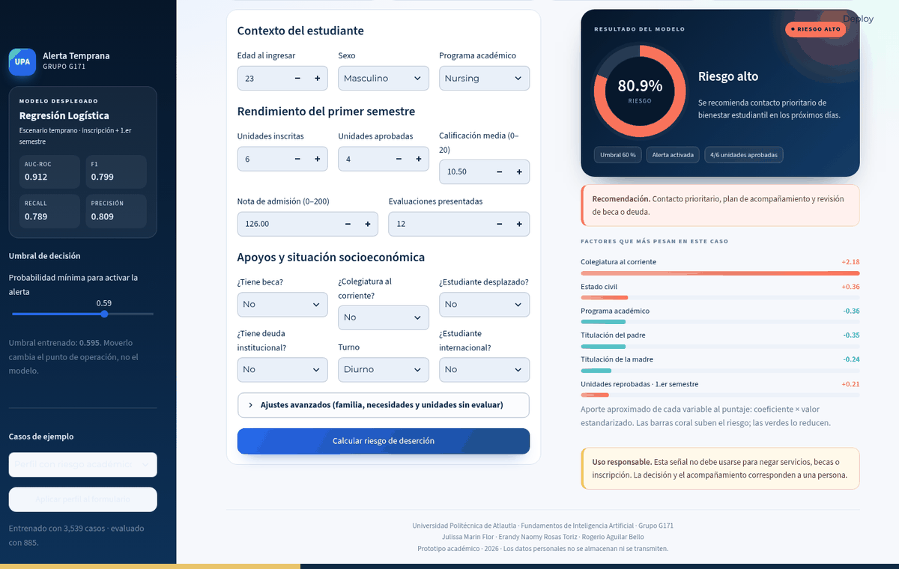

<div align="center">


# Alerta temprana de deserción escolar

**Un sistema supervisado que aprende de los datos para no perder estudiantes**

[](https://www.python.org/)
[](https://scikit-learn.org/)
[](https://streamlit.io/)
[](https://doi.org/10.24432/C5MC89)
[](https://creativecommons.org/licenses/by/4.0/)

**Universidad Politécnica de Atlautla** · Fundamentos de Inteligencia Artificial · Grupo **G171**
Actividad 3.2.1 — Aprendizaje Automático Supervisado · Docente: Javier García Lara

</div>

---

## ¿De qué trata?

Cada estudiante que abandona la universidad es una trayectoria interrumpida y una oportunidad perdida. Este proyecto construye un **sistema de alerta temprana** capaz de estimar, con datos disponibles al terminar el primer semestre, qué estudiantes tienen alta probabilidad de desertar — lo bastante pronto para que una tutoría, una beca o una flexibilidad académica cambien el desenlace.

El trabajo cubre el ciclo completo de un proyecto de aprendizaje automático supervisado: selección y verificación del dataset, análisis exploratorio, preprocesamiento sin fuga de información, comparación de **siete algoritmos** con `GridSearchCV`, análisis de sobreajuste, auditoría de equidad, selección justificada del modelo y despliegue en una **aplicación web funcional**.

<div align="center">

<br>
<sub>Demostración de la aplicación: predicción individual, evaluación del modelo y portada.</sub>
</div>

---

## Resultados principales

Modelo desplegado: **Regresión Logística** (`C = 10`, `class_weight='balanced'`, umbral `0.595`) entrenada con variables de inscripción y primer semestre.

| Métrica | Valor | Lectura |
|:--|--:|:--|
| **Accuracy** | `0.872` | 885 estudiantes en el conjunto de prueba |
| **Precision** | `0.809` | 81 % de las alertas corresponden a desertores reales |
| **Recall** | `0.789` | Se detectan 224 de los 284 desertores |
| **F1-score** | `0.799` | Equilibrio entre precisión y recall |
| **AUC-ROC** | `0.912` | Buena capacidad de ordenar el riesgo |
| **PR-AUC** | `0.871` | Sólido con prevalencia de 32.1 % |

**Matriz de confusión (prueba):** `[[548, 53], [60, 224]]` → 53 falsas alarmas y 60 estudiantes en riesgo no detectados.

> **Lectura honesta.** El F1 en validación cruzada es `0.768`, ligeramente por debajo del `0.789` de prueba. El desempeño realista en producción ronda **0.77**: la partición de prueba fue algo benevolente y así se reporta.

### Comparación de modelos (escenario temprano, ajustado)

| Modelo | F1 | Recall | AUC-ROC | Brecha F1 (train−test) |
|:--|--:|--:|--:|--:|
| **Regresión Logística** | **0.789** | **0.820** | 0.912 | **−0.008** |
| Random Forest | 0.780 | 0.778 | **0.913** | 0.221 |
| SVM (RBF) | 0.757 | 0.697 | 0.910 | 0.085 |
| Árbol de Decisión | 0.756 | 0.806 | 0.881 | 0.027 |
| Red Neuronal (MLP) | 0.733 | 0.648 | 0.892 | 0.021 |
| Naive Bayes | 0.723 | 0.736 | 0.860 | −0.023 |
| KNN | 0.683 | 0.581 | 0.844 | 0.317 |

La complejidad no compró precisión: **un modelo lineal, interpretable y barato ganó** a Random Forest, SVM y a la red neuronal.

<sub>La tabla compara los modelos con umbral 0.5. El modelo desplegado se evalúa con el umbral ajustado 0.595, que eleva el F1 a 0.799 y el recall a 0.789.</sub>

---

## Entregables

| # | Entregable | Archivo |
|:-:|:--|:--|
| 1 | Informe metodológico completo (25 páginas, APA 7) | [`docs/Informe_Metodologico.pdf`](docs/Informe_Metodologico.pdf) |
| 2 | Reporte de Fase 1 · selección del problema y dataset (1 página) | [`docs/Fase1_Reporte_Seleccion.pdf`](docs/Fase1_Reporte_Seleccion.pdf) |
| 3 | Presentación ejecutiva (12 diapositivas) | [`docs/Presentacion_Ejecutiva.pdf`](docs/Presentacion_Ejecutiva.pdf) · [`PPTX`](docs/Presentacion_Ejecutiva.pptx) |
| 4 | Aplicación web funcional | [`app/app.py`](app/app.py) |
| 5 | Notebooks ejecutados | [`01_EDA`](notebooks/01_EDA_y_Preprocesamiento.ipynb) · [`02_Modelos`](notebooks/02_Modelos_y_Comparacion.ipynb) |
| 6 | Modelo serializado + metadatos | [`models/`](models) |
| 7 | Resultados crudos y reproducibles | [`results/`](results) |

---

## El dataset

| Campo | Información |
|:--|:--|
| **Nombre** | Predict Students' Dropout and Academic Success |
| **Fuente** | UCI Machine Learning Repository — [ID 697](https://archive.ics.uci.edu/dataset/697/predict+students+dropout+and+academic+success) |
| **DOI** | [10.24432/C5MC89](https://doi.org/10.24432/C5MC89) |
| **Autores** | Realinho, Vieira, Neto y Costa (2021) |
| **Licencia** | CC BY 4.0 |
| **Tamaño** | 4 424 estudiantes × 36 variables + objetivo |
| **Calidad** | 0 valores nulos · 0 duplicados |
| **Objetivo original** | 3 clases: *Graduate* (2 209), *Enrolled* (794), *Dropout* (1 421) |
| **Objetivo del proyecto** | Binario: desertor `1` (32.1 %) vs. no desertor `0` (67.9 %) |

**Variables:** académicas (notas de admisión, unidades aprobadas, evaluaciones), demográficas (edad, sexo, estado civil) y socioeconómicas (beca, deuda, matrícula al día, ocupación de los padres, desempleo, inflación, PIB).

### Dos escenarios para evitar fuga temporal

| Escenario | Variables | Uso |
|:--|:--|:--|
| **A · Temprano** ✅ | Inscripción + primer semestre (82 columnas tras preprocesar) | **Desplegado.** La alerta llega cuando aún se puede intervenir. |
| **B · Completo** | Añade el segundo semestre (107 columnas) | Solo diagnóstico: +0.020 AUC, pero predice un desenlace que ya ocurrió. |

---

## Estructura del repositorio

```text
FIA_G171_Marin_Flor_AI32/
├── app/
│   └── app.py                     # Aplicación Streamlit (3 pestañas)
├── data/
│   ├── raw/                       # CSV original de UCI (sin modificar)
│   └── processed/                 # Dataset con variables derivadas
├── docs/
│   ├── Informe_Metodologico.pdf   # Informe de 25 páginas
│   ├── Fase1_Reporte_Seleccion.pdf
│   ├── Presentacion_Ejecutiva.pdf
│   └── figuras/                   # Figuras, portadas, QR y GIF de la app
├── models/
│   ├── modelo_desercion.pkl       # Pipeline preprocesador + modelo
│   └── metadata.json              # Umbral, rangos y métricas para la app
├── notebooks/
│   ├── 01_EDA_y_Preprocesamiento.ipynb
│   └── 02_Modelos_y_Comparacion.ipynb
├── results/                       # Métricas, parámetros, equidad y curvas
├── src/
│   ├── pipeline.py                # Fuente única de transformación
│   ├── train.py                   # Entrenamiento y comparación de modelos
│   ├── figuras.py                 # Figuras del informe
│   ├── graficos_extra.py          # Portadas, QR y GIF animado
│   ├── docx_util.py               # Estilos del documento
│   ├── generar_informe.py         # Informe y reporte de Fase 1
│   └── generar_presentacion.py    # Presentación ejecutiva
├── requirements.txt
└── README.md
```

---

## Reproducción

```bash
# 1. Clonar el repositorio
git clone https://github.com/julR-mz93/Fundamentos-de-Inteligencia-Artificial.git
cd Fundamentos-de-Inteligencia-Artificial/FIA_G171_Marin_Flor_AI32

# 2. Crear el entorno e instalar dependencias
python -m venv .venv
source .venv/bin/activate          # Windows: .venv\Scripts\activate
pip install -r requirements.txt

# 3. Entrenar y comparar los siete modelos (~14 min)
python src/train.py

# 4. Regenerar figuras y documentos
python src/figuras.py
python src/generar_informe.py
python src/generar_presentacion.py

# 5. Abrir la aplicación
streamlit run app/app.py
```

> Todo el proyecto usa `random_state = 42`. Las métricas del informe se leen de `results/`; cualquier cifra citada puede rastrearse hasta un archivo y reproducirse.
>
> **Demostración rápida:** con la app abierta, `http://localhost:8501/?perfil=riesgo` carga un caso de riesgo alto y `?perfil=apoyo` un caso sin alerta. Las capturas y el GIF se regeneran con `python src/capturar_app.py` (app corriendo) y `python src/graficos_extra.py`.

---

## Metodología en una mirada

| Elemento | Definición |
|:--|:--|
| **Tarea** | Clasificación binaria supervisada |
| **Partición** | 80 % entrenamiento (3 539) / 20 % prueba (885), estratificada |
| **Validación** | `StratifiedKFold` de 5 pliegues sobre entrenamiento |
| **Búsqueda** | `GridSearchCV` con F1 como métrica de selección |
| **Balanceo** | `class_weight='balanced'` — sin SMOTE |
| **Modelos** | Regresión Logística, KNN, SVM-RBF, Árbol, Random Forest, MLP, Naive Bayes |
| **Métricas** | Accuracy, precision, recall, F1, AUC-ROC, PR-AUC, matriz de confusión |
| **Sobreajuste** | Brecha F1 train−test + media y desviación entre pliegues |
| **Umbral** | `0.595`, elegido para maximizar F1 y priorizar el recall |

---

## Ética, sesgo y gobernanza

El modelo **no es neutral**. La auditoría por subgrupos encontró brechas que se documentan y se muestran dentro de la propia aplicación:

| Grupo | Recall |
|:--|--:|
| Mujeres | 0.836 |
| Hombres | 0.739 |
| Sin beca | 0.820 |
| **Con beca** | **0.517** |
| **≤ 20 años** | **0.667** |
| Con deuda | 0.981 |

**Reglas de uso adoptadas:**

1. El puntaje **dispara una conversación humana**, nunca una sanción, una negación de servicios o una baja automática.
2. `Sexo` y `Edad` se conservan **solo para auditoría de equidad**, no como variables del modelo.
3. Cada reentrenamiento debe reportar métricas por subgrupo.
4. La aplicación no almacena datos personales: todo se procesa en memoria.
5. Los resultados se comunican con sus límites, no como certezas.

---

## Declaración de uso de inteligencia artificial

Se utilizó **OpenCode · Big Pickle (versión 2026)** como copiloto de programación, revisión de redacción, generación de figuras y apoyo de maquetación. Todo el código fue ejecutado y verificado; las métricas provienen de `results/` y son reproducibles con `src/train.py`. Las decisiones de diseño —binarizar la etiqueta, separar escenarios para evitar fuga temporal, elegir la regresión logística por interpretabilidad y documentar las brechas de equidad— son responsabilidad del equipo.

**Referencia APA 7:**

> OpenCode. (2026). *Big Pickle* (versión 2026) [Modelo de lenguaje de gran escala]. https://opencode.ai

---

## Equipo

| Integrante | Grupo |
|:--|:--|
| Julissa Marin Flor | G171 |
| Erandy Naomy Rosas Toriz | G171 |
| Rogerio Aguilar Bello | G171 |

Ingeniería en Tecnologías de la Información e Innovación Digital
Universidad Politécnica de Atlautla

---

## Referencias principales

- Bishop, C. M. (2006). *Pattern recognition and machine learning*. Springer.
- Géron, A. (2022). *Hands-on machine learning with scikit-learn, Keras and TensorFlow* (3.ª ed.). O'Reilly.
- Realinho, V., Vieira, M., Neto, C., & Costa, E. (2021). *Predict Students' Dropout and Academic Success* [Conjunto de datos]. UCI Machine Learning Repository. https://doi.org/10.24432/C5MC89
- Russell, S., & Norvig, P. (2021). *Artificial intelligence: A modern approach* (4.ª ed.). Pearson.

<div align="center">
<br>
<sub>Universidad Politécnica de Atlautla · Actividad 3.2.1 · Aprendizaje Automático Supervisado · 2026</sub>
</div>
